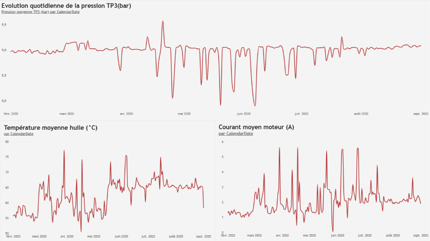
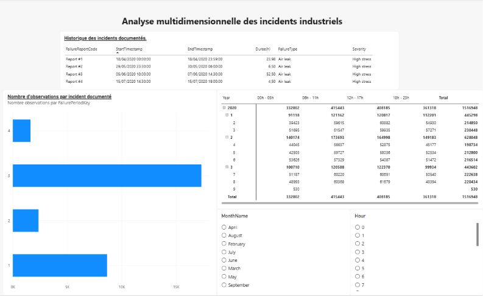

# Smart Industrial Maintenance BI — MetroPT-3


Projet académique de Business Intelligence réalisé à l'ENSAM Rabat, filière INDIA, à partir du dataset **MetroPT-3**. Le projet transforme des observations de capteurs d'une unité de production d'air comprimé ferroviaire en un modèle décisionnel exploitable dans Power BI, avec ETL Power Query/M, mesures DAX, analyse temporelle et exploration OLAP.

Les auteurs sont **Saad Sahraoui**, **Hassan El Hajjam** et **Yassine Saddane**, sous l'encadrement de **Pr. Safaâ Dafrallah**, à l'**ENSAM Rabat — Université Mohammed V**, année universitaire **2026/2027**.

## Résultats vérifiés

Les valeurs ci-dessous proviennent du CSV MetroPT-3 et des quatre périodes d'incident documentées. Elles décrivent une association temporelle inclusive ; une observation associée à une fenêtre ne constitue pas automatiquement une panne individuelle.

| Indicateur | Valeur | Interprétation |
| --- | ---: | --- |
| Observations IoT | **1 516 948** | Lignes du CSV source |
| Incidents documentés | **4** | Périodes externes fournies avec la documentation |
| Observations dans les périodes incidentées | **29 954** | Timestamps compris entre les bornes inclusives |
| Taux d'observations incidentées | **1,97 %** | 29 954 / 1 516 948 |

Le projet ne fournit ni coût de maintenance, ni disponibilité, ni MTBF/MTTR, ni modèle prédictif validé. Il s'agit d'une solution décisionnelle historique et documentée, pas d'un système de maintenance prédictive opérationnel.

## Contexte industriel

L'**Air Production Unit (APU)** produit et distribue l'air comprimé nécessaire aux fonctions pneumatiques d'un train. Le périmètre MetroPT-3 concerne un compresseur installé dans un train de métro portugais. Les signaux couvrent notamment la pression, la température de l'huile, le courant moteur et des états numériques.

La problématique est d'organiser des signaux IoT hétérogènes et des rapports d'incidents séparés afin de permettre une lecture fiable du fonctionnement de l'APU et des événements documentés.

## Architecture de la solution

```text
CSV MetroPT-3 + rapports d'incidents
                 |
                 v
      Préparation Python et Power Query/M
                 |
                 v
 FactSensorObservation   FactFailurePeriod
          |                      |
          +----------+-----------+
                     |
            DimDate / DimTime
                     |
                     v
          Modèle Power BI + DAX
                     |
                     v
       Vue générale | Capteurs | Incidents & OLAP
```

Le modèle est une constellation minimale à deux faits :

- `FactSensorObservation` : une ligne par observation source et timestamp, avec les signaux et les clés temporelles.
- `FactFailurePeriod` : une ligne par période d'incident documentée, avec ses bornes, sa durée et son contexte source.
- `DimDate` : calendrier et hiérarchie annuelle/mensuelle/journalière.
- `DimTime` : seconde de la journée, heure, minute et tranches horaires.

Les relations et leurs cardinalités sont documentées dans [`model/dimensional_model.md`](./model/dimensional_model.md). Les tables de faits ne sont pas reliées directement entre elles.

## Pipeline ETL et reproductibilité

Le fichier original `data/raw/MetroPT3(AirCompressor).csv` reste local et n'est pas versionné. Le script Python lit le CSV sans le modifier et prépare les quatre tables sous `data/processed/`. Les requêtes M correspondantes se trouvent dans [`powerquery/`](./powerquery).

Pré-requis : Python 3.12 ou supérieur, Power BI Desktop pour le chargement du modèle, et les dépendances Python utilisées par l'audit (`pandas`, `pypdf`).

```powershell
cd smart-industrial-maintenance-bi
python scripts/audit_data.py
python scripts/prepare_powerbi_data.py
```

Pour Power Query, définir le paramètre `pSourceFolder` vers le dossier local `data/raw`, puis charger les requêtes dans l'ordre décrit dans [`docs/powerbi_implementation_guide.md`](./docs/powerbi_implementation_guide.md). Les chemins M restent configurables et le CSV source n'est jamais réécrit.

## Mesures DAX

Les sept mesures vérifiées sont dans [`dax/measures.dax`](./dax/measures.dax) :

1. Nombre observations
2. Pression moyenne TP3 (bar)
3. Température moyenne huile (°C)
4. Courant moyen moteur (A)
5. Nombre incidents documentés
6. Observations dans incidents documentés
7. Taux observations incidentées

Les mesures sont calculées dans le modèle sémantique. Les valeurs affichées dans les dashboards ne sont pas codées en dur.

## Dashboards Power BI

Le rapport Power BI contient trois pages :

1. **Vue générale** : KPI globaux, évolution quotidienne des observations et durée des incidents documentés.
2. **Surveillance des capteurs** : pression TP3, température de l'huile et courant moteur, avec analyse temporelle.
3. **Incidents et OLAP** : historique des quatre incidents, observations associées, matrice temporelle et filtres `MonthName` et `Hour`.

Les captures représentatives ci-dessous sont des illustrations redessinées à partir des pages Power BI finales. Elles ne remplacent pas le fichier PBIX interactif.

### Vue générale


### Surveillance des capteurs



### Incidents et OLAP



Le thème Power BI est disponible dans [`powerbi/themes/industrial_premium_theme.json`](./powerbi/themes/industrial_premium_theme.json), avec des icônes industrielles sous [`powerbi/themes/icons/`](./powerbi/themes/icons).

## Rapport et présentation

| Livrable | Fichier |
| --- | --- |
| Rapport académique PDF | [`BI_MetroPT_Report/output/BI_MetroPT_Report.pdf`](./BI_MetroPT_Report/output/BI_MetroPT_Report.pdf) |
| Sources LaTeX | [`BI_MetroPT_Report/main.tex`](./BI_MetroPT_Report/main.tex), [`BI_MetroPT_Report/preamble.tex`](./BI_MetroPT_Report/preamble.tex) |
| Présentation PowerPoint modifiable | [`presentation_pfe/output/MetroPT3_PFE_Presentation_Premium.pptx`](./presentation_pfe/output/MetroPT3_PFE_Presentation_Premium.pptx) |
| PDF final de soutenance | [`presentation_pfe/output/SMART INDUSTRIAL MAINTENANCE — Version finale—.pdf`](<./presentation_pfe/output/SMART INDUSTRIAL MAINTENANCE — Version finale—.pdf>) |
| Notes orales | [`presentation_pfe/notes_orales.md`](./presentation_pfe/notes_orales.md) |
| Présentation Canva | [Version finale Canva](https://www.canva.com/d/ATJE0o0qA9oBnpT) |

Le PDF de soutenance ajouté manuellement dans `presentation_pfe/output/` est conservé comme référence finale. Le PPTX contient 22 diapositives et 22 notes orales, ainsi que les six illustrations du projet.

## Arborescence utile

```text
smart-industrial-maintenance-bi/
├── BI_MetroPT_Report/     # rapport LaTeX et figures
├── data/raw/              # sources locales, ignorées par Git
├── data/processed/        # tables dérivées locales, ignorées par Git
├── dax/                   # mesures DAX
├── docs/                  # audits, dictionnaire et guides
├── model/                 # modèle dimensionnel et bus matrix
├── powerbi/               # PBIX, thème et icônes
├── powerquery/            # requêtes M
├── presentation/          # six illustrations sources
├── presentation_pfe/      # script, assets, PPTX, PDF et notes
├── reports/figures/       # captures utilisées dans le rapport/README
├── scripts/               # audit et préparation Python
├── .gitignore
├── LICENSE
└── README.md
```

## Limites et perspectives

Les quatre périodes d'incident viennent de rapports externes au CSV et sont associées par timestamp inclusif. Le dataset ne permet pas d'inférer seul la causalité, les interventions, les coûts ou la disponibilité. Les perspectives naturelles sont l'ajout de labels de maintenance validés, la détection d'anomalies, l'entraînement de modèles de machine learning, l'automatisation du rafraîchissement et l'étude de flux quasi temps réel. Ces extensions ne sont pas implémentées dans ce dépôt.

## Sources et licence

- Dataset : [MetroPT-3 Dataset — UCI Machine Learning Repository](https://archive.ics.uci.edu/dataset/791/metropt+3+dataset)
- Publication : [The MetroPT dataset for predictive maintenance](https://doi.org/10.1016/j.dib.2022.108140)
- Documentation technique locale : [`data/raw/Data Description_Metro.pdf`](./data/raw/Data%20Description_Metro.pdf) lorsqu'elle est disponible localement.
- Code et documentation du projet : [LICENSE](./LICENSE), licence MIT.
- Les conditions de réutilisation du dataset restent celles de son fournisseur et de sa licence d'origine ; le CSV brut n'est pas redistribué par ce dépôt.

## Auteurs

- Saad Sahraoui
- Hassan El Hajjam
- Yassine Saddane

Encadrante : Pr. Safaâ Dafrallah<br>
ENSAM Rabat — Université Mohammed V<br>
Filière INDIA — Année universitaire 2026/2027
